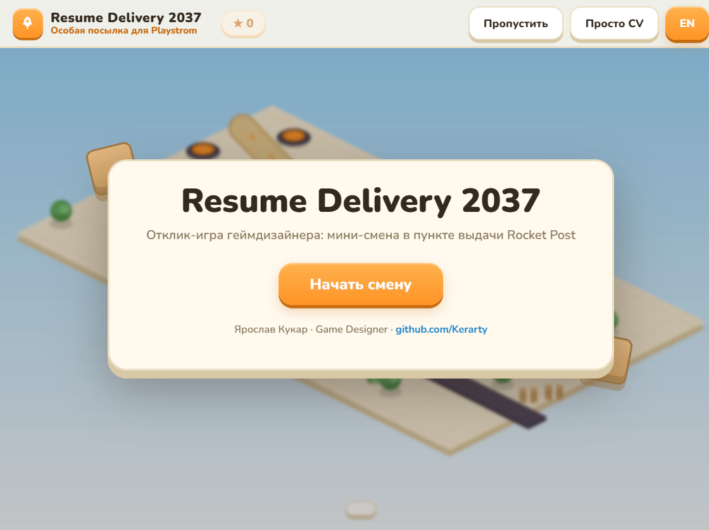
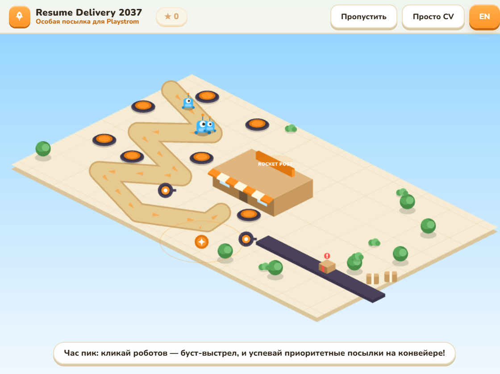
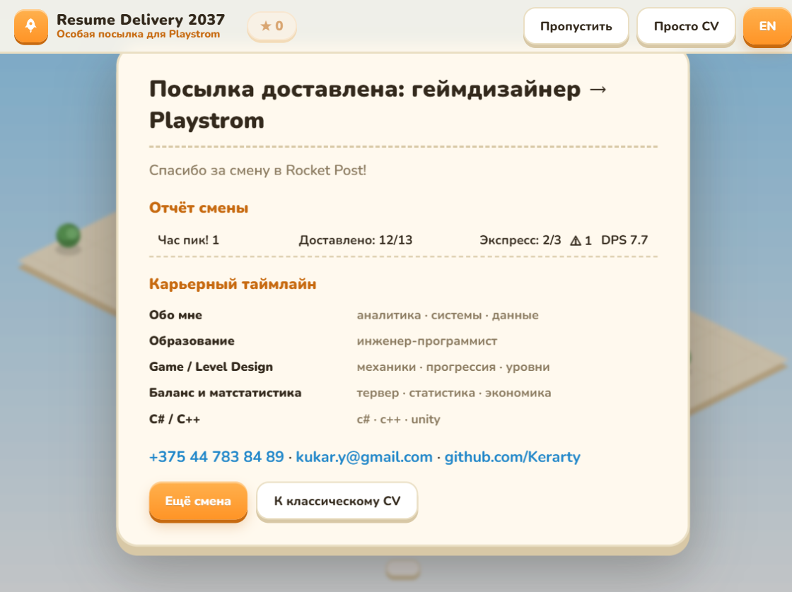
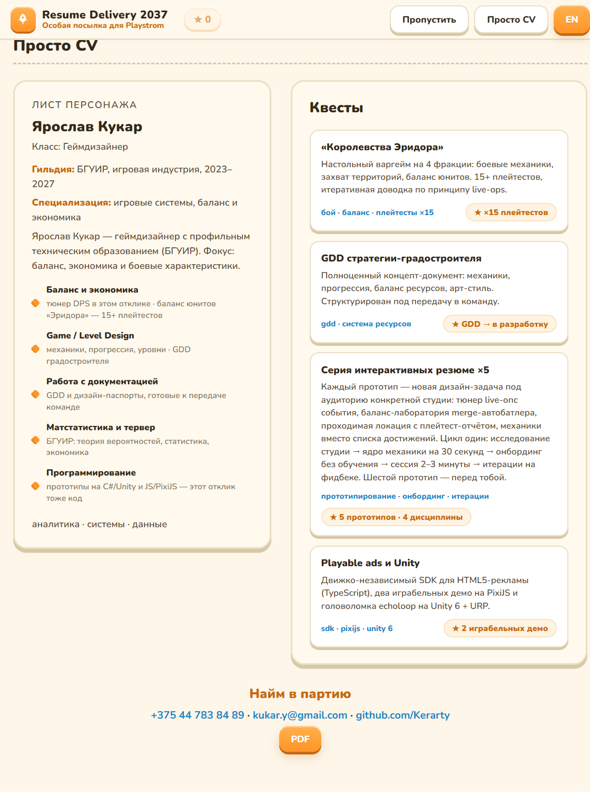

# Resume Delivery 2037

Играбельный отклик на вакансию геймдизайнера в [Playstrom](https://playstrom.by): мини-смена в пункте выдачи **Rocket Post** из их нового PC-проекта *Shipping Store Simulator 2037*. Это шестая работа в моей серии игровых резюме (до этого — отклики для Playrix, Lesta, Top Games, Igrotech и Gametech): вместо списка достижений — механики, в которые можно поиграть за три минуты.

**Играть:** [kerarty.github.io/cv-playstrom](https://kerarty.github.io/cv-playstrom/)

## Как это устроено

Карта — как в классических tower defense: извилистая дорога ведёт через всю локацию к двери пункта выдачи Rocket Post, вдоль неё — круглые площадки для башен, с другой стороны карты к окну выдачи катятся контейнеры-посылки.

По конвейеру приезжают посылки — разделы резюме. Кликаешь по коробке — она сканируется, открывает карточку факта, приносит **очко** и открывает новый тип башни. Клик по площадке — меню выбора: построй одну из открытых башен за очко или клик по своей башне — улучши её (уровень даёт +35% урона и +10% радиуса). Типы башен растут из содержимого посылок: пушка из Game Design, снайпер из баланса и матстатистики, пулемёт из C#, мортиры из проектов, дроны-замедлители из серии резюме, усилитель из образования.

В «час пик» волны роботов QuickBox идут по дороге к магазину, а по конвейеру параллельно едут **приоритетные посылки**: успей кликнуть до окна выдачи — +1 очко в казну, прозевал — потерянный заказ в отчёте смены. Между волнами работает **тюнер баланса**: три очка на урон/скорострельность/радиус арсенала с живым предрасчётом DPS и прогноза прорывов. В финале ракета доставляет посылку «геймдизайнер → Playstrom» с контактами и отчётом смены.

| Интро | Час пик | Финал с отчётом |
|---|---|---|
|  |  |  |

Классическое резюме живёт прямо на странице — в виде листа персонажа с квестами:

Принципы, которые я заложил в отклик:

- **Рекрутера нельзя проиграть.** Помятая посылка только портит «идеальную волну», пропуск ведёт сразу к контактам, классическое CV доступно в один клик.
- **Тюнер — моя подпись.** Баланс и экономика — то, что я люблю больше всего, поэтому посреди отклика стоит живая баланс-лаборатория.
- **Каждая посылка — решение.** Строить или улучшать, куда ставить башню — те же выборы, что я делаю как дизайнер, только в миниатюре.
- **Сеттинг — их язык.** Обёртка из *Shipping Store Simulator 2037*, экшен из *TDS*, палитра Rocket Post против неона QuickBox.

## Стек

Чистый веб без сборки: HTML + CSS + ES-модули, [PixiJS 8](https://pixijs.com/) (лежит в репозитории, никаких CDN). Арт — плоский вектор в изометрии, нарисован кодом через Graphics. Локализация RU/EN переключателем, контент посылок и волн — в `js/data.js`, тексты — в `js/loc.js`.

## Запуск

Локально: `python serve.py` (простой сервер с отключённым кэшем) → http://localhost:8377. Деплой — GitHub Pages из корня `main`.

Дизайн-документ: [PLAN.md](PLAN.md). Классическое резюме: [docs/CV_Yaroslav.pdf](docs/CV_Yaroslav.pdf).

## Контакт

Ярослав Кукар · +375 44 783 84 89 · kukar.y@gmail.com · [github.com/Kerarty](https://github.com/Kerarty)
